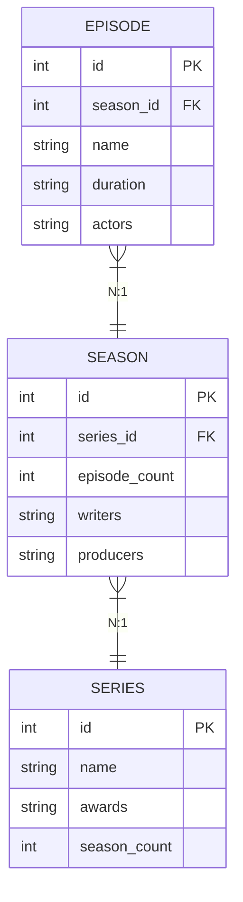

Relational data base concepts

table
- a group of columns with attributes describing a record

record
- group of attributes describing an object, 
where each object is called record 
when on the row some fields store the data of the object

identifiers
- could be the names of the tables and columns or the primary key which identifies
each row uniquely

how records link
- using foreign keys connected to another table primary key 

relationship types
- one to many 
- many to many
- many to one

normalization
(1-6NF)
1NF - remove duplicated columns or multi value columns
2NF - 1NF + every column depends on the entire primary key
3NF - 2Nf + every column should depend only on the key and nothing else no other column.
If you have such columns present you should put them in other tables

